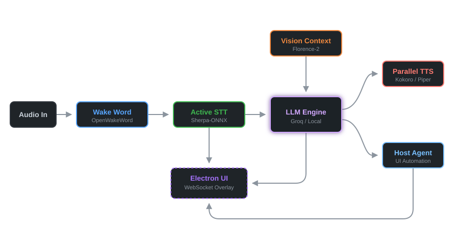

<div align="center">
  
  <h1>Kuro-LLM</h1>
  <p><b>Ultra-Low Latency, Event-Driven Agentic Desktop Assistant</b></p>
  <p>
    <a href="#"></a>
    <a href="#"></a>
    <a href="#"></a>
    <a href="#"></a>
  </p>
</div>

<br/>

Kuro is an advanced, unified Agentic Desktop Assistant designed for ultra-low latency voice interactions and dynamic system automation. By leveraging a high-performance Python backend and a sleek Electron frontend, Kuro combines the privacy and speed of local AI models with the extreme intelligence of cloud fallback capabilities.

---

## 🏗️ System Architecture

<div align="center">

</div>

---

## ⚡ 4-Stage Execution Pipeline

Kuro operates on a highly optimized, fully async event loop designed to reduce end-to-end response times below 1.5 seconds. 

1. **Passive Wake Word & Greeting**  
   The system passively listens using `OpenWakeWord`. Upon detecting "Hey Kuro", it immediately drains the audio buffer and synthesizes a randomized sub-50ms verbal acknowledgment (e.g., *"Yeah?"*).
2. **Active STT Listening**  
   The microphone instantly arms. `Sherpa-ONNX` (streaming Zipformer ASR) captures the user's command, emitting 50ms partial transcripts directly to the Electron frontend for live subtitle rendering.
3. **Intent Parsing & Vision Context**  
   The final transcript (and optional `Florence-2` visual screen context) is routed through the fast reasoning engine (`Groq LPU` or `Ollama local`). The engine isolates exact user intent and formulates a structured execution payload.
4. **Parallel Execution (TTS + Action)**  
   To entirely mask latency, two async tasks spin up simultaneously: 
   - **Voice Acknowledgment**: TTS synthesizes a brief confirmation phrase (e.g., *"On it..."*).
   - **Agent Execution**: The `HostAgent` or `ActionRouter` dynamically controls the desktop utilizing `uiautomation` and `pywinauto`.

## 🛠️ Technology Stack

- **Frontend Environment**: `Electron`, `React`, `Node.js`.
- **Backend API Core**: `Python 3`, `FastAPI`, `Uvicorn`, `WebSockets`.
- **Large Language Models**: `Groq API` (Llama-3), `Ollama` (Local processing).
- **Audio Processing**: `OpenWakeWord`, `Sherpa-ONNX`, `Kokoro-onnx`, `Piper-TTS`.
- **Desktop Automation**: `uiautomation`, `pywinauto`, `mss` (Vision screenshots).

## 🚀 Getting Started

Ensure you have Python 3.11+ and Node.js installed.

1. **Clone and Configure**
   ```bash
   git clone https://github.com/Goutham-K-278/Kuro.git
   cd Kuro
   cp .env.example .env
   # Add your GROQ_API_KEY and Spotify credentials to the .env file
   ```

2. **Start Backend (Python API)**
   ```powershell
   ./scripts/dev.ps1
   ```
   *(Starts FastAPI server and loads ONNX models into memory).*

3. **Start Frontend (Electron UI)**
   ```bash
   cd kuro-ai
   npm install
   cd desktop && npm start
   ```

**Enjoy lightning-fast agentic assistance directly from your desktop overlay!**
